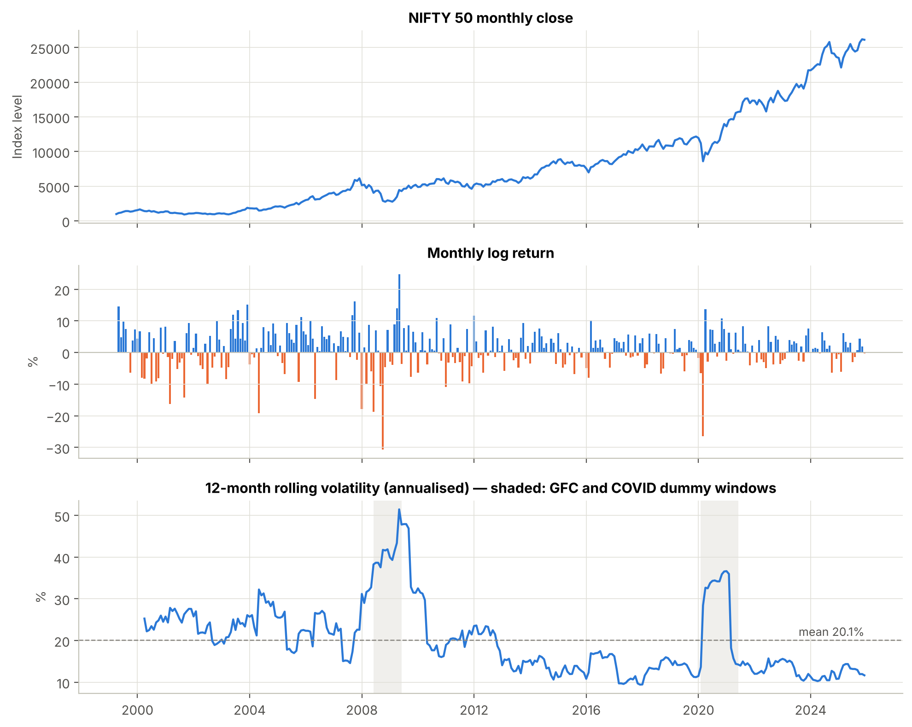
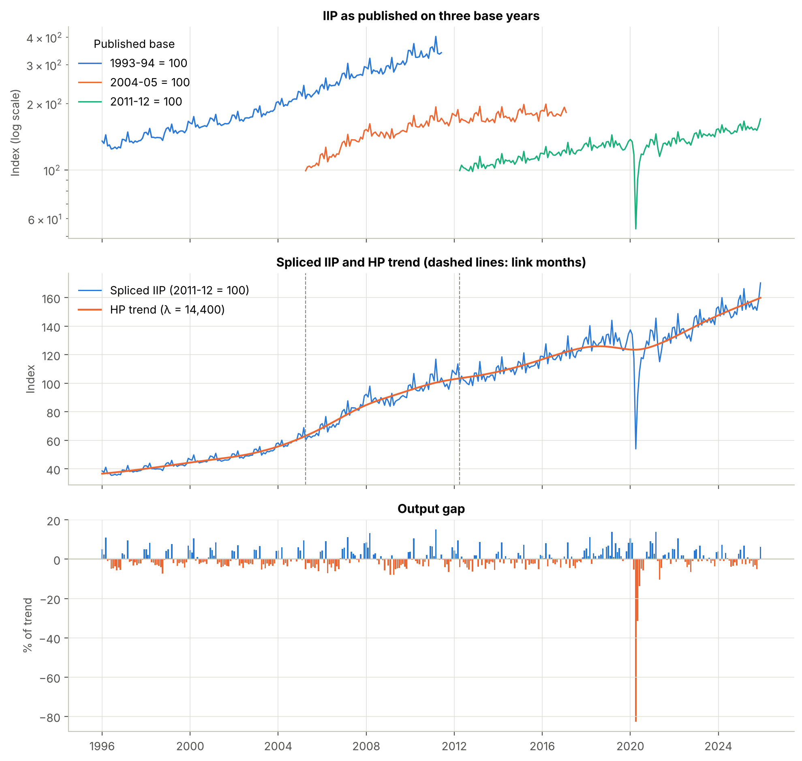

# Trade Policy Uncertainty, Geopolitical Risk and Stock Market Volatility: Evidence from India

**Himanshu Mahale** · Undergraduate research project in Economics, IIT Kanpur · Supervisor: Prof. Sanjiv Kumar

This project studies whether global trade policy uncertainty (TPU) and geopolitical risk (GPR) affect the volatility of
the Indian stock market. It uses monthly NIFTY 50 data from April 1999 to December 2025 and combines a GARCH-X model of
returns, ARDL bounds tests, a structural VAR, a time-varying-parameter regression and a set of machine-learning models
evaluated out of sample.

📄 **Paper:** [`final_report.pdf`](final_report.pdf) (two-column, 17 pages; LaTeX source in [`paper/`](paper/))
📓 **Analysis:** [`final_analysis.ipynb`](final_analysis.ipynb) reproduces every table and figure in the paper
🧱 **Data preparation:** [`data_preparation.ipynb`](data_preparation.ipynb) documents the sources, the cleaning and the construction of the output gap

---

## Main findings

1. **Trade policy uncertainty does not raise volatility.** Its coefficient in the GARCH-X variance equation is small and
   negative (δ₁ = −0.0053, p = 0.095). It is insignificant in both ARDL models, in the SVAR and in every month of the
   time-varying regression, including the 2025 tariff escalation.
2. **Geopolitical risk has a small negative long-run effect.** In the log-volatility ARDL its long-run multiplier is
   −0.00125 (p = 0.026), about −6% per standard deviation, concentrated in 2020–22.
3. **The two do not reinforce each other.** The TPU × GPR interaction is never significant.
4. **External shocks arrive through US monetary policy uncertainty.** Both ARDL bounds tests find a long-run level
   relationship (F = 3.63 and 6.75, above the 5% upper bounds), driven by the exchange rate (negative) and US monetary
   policy uncertainty (positive), not by TPU.
5. **Volatility is driven by its own past.** Own shocks explain more than 99% of its forecast-error variance at every
   horizon up to 24 months; a shock's half-life is about 3.8 months.
6. **Machine learning does not beat persistence.** Out of sample (Dec 2020 – Dec 2025), an AR(1) has the lowest error.
   LASSO and the elastic net are statistically indistinguishable from it; the tree ensembles are significantly worse.

**What this means.** Headline trade-policy and geopolitical uncertainty are not important drivers of monthly volatility
in Indian equities, and the null result for TPU holds across five methods. External shocks reach Indian markets mainly
through US monetary policy uncertainty and global risk aversion (VIX). Once a volatile period starts, it runs its course
over many months largely regardless of the uncertainty indices, which is also why flexible ML models find no signal
beyond persistence. The estimates are associations, not causal effects, and they apply to monthly rolling volatility;
the paper discusses these limits and the extensions that would test them (daily realised volatility, India-specific
uncertainty measures, event studies).

| Model | Key result |
|---|---|
| GARCH-X(1,1) | α + β = 0.937; LR test vs GARCH(1,1): χ²(4) = 3.52, p = 0.475 |
| Johansen (TPU, GPR, volatility) | VAR(1) in levels; full rank (3 of 3) at lags 0–2 → system stationary in levels |
| ARDL(2,2), volatility in levels | R² = 0.932; bounds F = 3.63 (5% bounds 2.06 / 3.24) |
| ARDL(1,0), log volatility | Bounds F = 6.75 (5% bounds 2.22 / 3.40); long run: GPR −0.00125\*\*, FX −0.0192\*\*\*, MPU +0.0021\*\*\* |
| SVAR (TPU → GPR → volatility) | 24-month variance share of volatility: TPU 0.91%, GPR 0.01%, own shocks 99.08% |
| TVP regression (Kalman filter) | TPU never significant; GPR significantly negative Jul 2020 – Jan 2022 |
| ML, test RMSE | AR(1) 0.0244 · naive 0.0246 · elastic net 0.0257 · LASSO 0.0259 · random forest 0.0286–0.0399 · XGBoost 0.0421 |



---

## Data

Monthly data, April 1999 – December 2025 (321 months). Indian macroeconomic series are from **CEIC**; the other series
are from the institutions that publish them.

| Variable | Description | Source |
|---|---|---|
| NIFTY 50 | Monthly closing level | National Stock Exchange of India |
| IIP | Index of Industrial Production, 1993-94, 2004-05 and 2011-12 bases (MOSPI) | CEIC |
| CPI_GR | CPI inflation, % year on year | CEIC |
| FX_USD | INR per USD, monthly average | CEIC |
| Int_Rate | Weighted average call money rate, % | CEIC (RBI) |
| TPU | Trade Policy Uncertainty index (Caldara et al., 2020) | matteoiacoviello.com/tpu.htm |
| GPR | Geopolitical Risk index (Caldara & Iacoviello, 2022) | matteoiacoviello.com/gpr.htm |
| MPU | US Monetary Policy Uncertainty index | policyuncertainty.com |
| US_EPU | US Economic Policy Uncertainty index | policyuncertainty.com |
| US_VIX | CBOE VIX (FRED series VIXCLS), monthly mean of daily closes | FRED |

**Compiled panel.** All series are dated to the first of the month, harmonised to monthly frequency and compiled into a
single file, `data/Compiled.xlsx` (sheet `X_var`), so that every model loads the same data from one place.

**Cleaning.** Every series was screened for observations more than four standard deviations from its mean. One data
error was corrected: the March 2007 call money rate (54.32%) is replaced with the monthly average published in the RBI
*Handbook of Statistics* (14.07%).

**Output gap.** The IIP is published on three base years whose levels are not comparable. The 2004-05 series is linked
to the 2011-12 base by its ratio in April 2012, and the 1993-94 series to the linked 2004-05 series by its ratio in April
2005. The spliced index is logged and HP-filtered (λ = 14,400), and the gap is 100 × the cycle. The rebuilt gap matches
CEIC's linked series and the `Output_Gap` column of `Compiled.xlsx` to within 10⁻⁹ (see `data_preparation.ipynb`).



**Volatility measure.** The 12-month rolling standard deviation of monthly log returns, annualised (× √12), is the
dependent variable of every model after the GARCH stage. The estimation sample is April 2000 – December 2025 (N = 309).

### Data availability

The CEIC series (IIP, CPI, exchange rate, call money rate) come from a **paid subscription database whose terms do not
allow redistribution**, so they are **not included in this public repository**. This also applies to
`data/Compiled.xlsx` and `outputs/master_dataset.xlsx`, which contain them; all of these are listed in `.gitignore`.
[`data/README.md`](data/README.md) lists the CEIC series, including the IIP series IDs (18989701, 314398401, 386587797),
and the folder each file goes in. With these files in place, both notebooks reproduce every result. All other series
are publicly available.

---

## Methods

| Stage | Method | Purpose |
|---|---|---|
| 1 | GARCH-X(1,1) on monthly returns (maximum likelihood) | Do TPU and GPR enter the conditional mean or variance of returns? |
| 2 | ADF, Phillips–Perron, KPSS, Zivot–Andrews | Orders of integration: a mixture of I(0) and I(1), nothing I(2) |
| 2 | Johansen trace test (lag = VAR lag − 1) | Specification of the SVAR / TVP system |
| 2 | ARDL bounds tests (Pesaran, Shin & Smith, 2001) | Long-run relationship with mixed I(0)/I(1) regressors |
| 2 | Structural VAR, Cholesky identification | Impulse responses and variance decomposition |
| 2 | Time-varying-parameter regression (Kalman filter) | Whether the effects change over time |
| 3 | LASSO, ridge, elastic net, random forest, XGBoost + SHAP | Out-of-sample nowcasting vs naive and AR(1) benchmarks, Diebold–Mariano tests |

---

## Repository structure

```
├── final_report.pdf             the paper (two-column)
├── final_analysis.ipynb         final, cleaned analysis notebook: all models, tables and figures
├── data_preparation.ipynb       data sources, cleaning, IIP splicing and HP-filter output gap (runs on its own, e.g. in Colab)
├── data/
│   ├── README.md                data sources, CEIC series IDs and where to place each file
│   ├── Compiled.xlsx            compiled monthly panel, sheet X_var (not public: contains CEIC data)
│   ├── NSE_monthly_final.csv    NIFTY 50 monthly prices
│   ├── IIP/                     CEIC exports of the IIP on the three base years (not public)
│   └── raw/                     original downloads by source: ceic/ (not public), uncertainty/, fred/
├── outputs/
│   ├── figures/                 all figures (PNG, 200 dpi)
│   ├── tables/                  all tables (CSV) and key_results.json
│   ├── results_tables.xlsx      all tables, one sheet each
│   └── master_dataset.xlsx      panel with returns, rolling and GARCH-X volatility (not public)
├── paper/                       LaTeX source (main.tex), bibliography, figures and compiled PDF
├── archive/original_notebooks/  original working notebooks (raw work)
├── requirements.txt
└── README.md
```

### Raw work

The notebooks in [`archive/original_notebooks/`](archive/original_notebooks/) (`UGP.ipynb`, `UGP_1.ipynb`,
`UGP_2.ipynb`, `UGP_3.ipynb`) contain the original exploratory work: downloading and merging the data, early volatility
measures, first versions of the models and the machine-learning experiments. **Anyone who wants to see the raw work
can look at this folder.** `final_analysis.ipynb` is the final cleaned version, and all results in the paper come from it.

---

## Reproducing the results

1. Place the CEIC files as described in [`data/README.md`](data/README.md).
2. Install the requirements and run the notebooks:

```bash
pip install -r requirements.txt
jupyter nbconvert --to notebook --execute --inplace data_preparation.ipynb   # output gap construction and checks
jupyter nbconvert --to notebook --execute --inplace final_analysis.ipynb     # all models, about 5–8 minutes on 2 CPUs
```

Both notebooks also run on Google Colab: upload the notebook and run the first code cell, which asks for the data files.
Figures and tables are written to `outputs/`. To rebuild the paper, copy `outputs/figures/*.png` to `paper/figures/` and
run `latexmk -pdf main.tex` inside `paper/`, or upload `paper/` to Overleaf.

---

## Citation

Mahale, H. (2026). *Trade Policy Uncertainty, Geopolitical Risk and Stock Market Volatility: Evidence from India.*
Undergraduate research project, Indian Institute of Technology Kanpur.
Code and data: https://github.com/himdev20/TPU_GPR_Market_volatility
